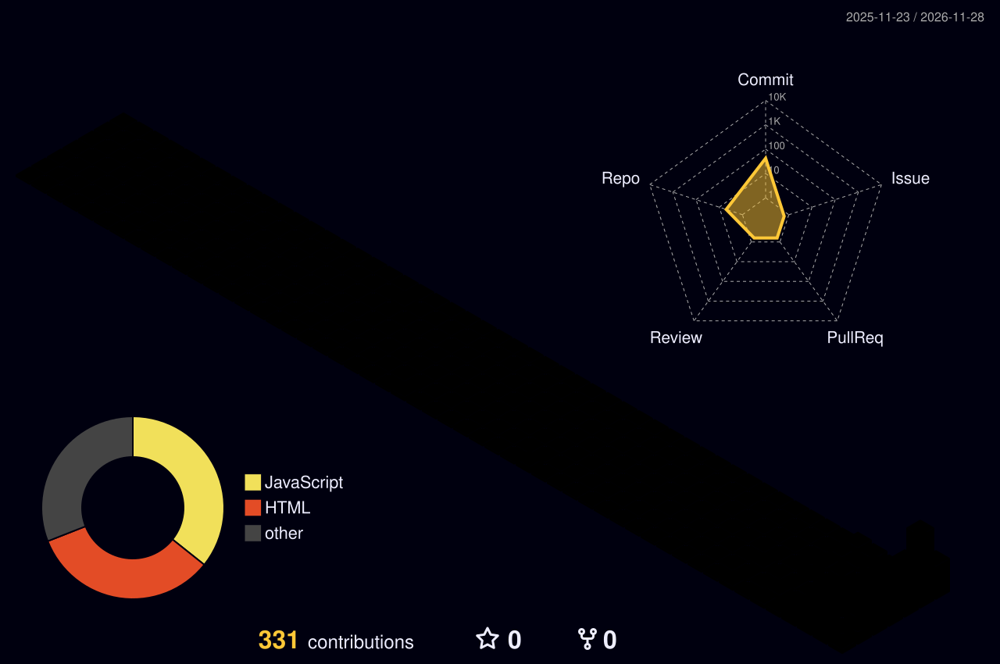
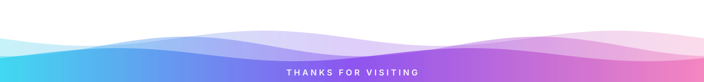

  

  

<h2 align="center">Tech Stack</h2>

  

<h2 align="center">Featured Projects</h2>

<table align="center">
  <tr>
    <td align="center" width="50%">
      
       
      <a href="https://almoallem.centerjo.workers.dev/"><b>Live site</b></a> &nbsp;·&nbsp;
      <a href="https://github.com/Abdelrahman-Alrawashdeh/al-moallem-driving-center"><b>Source</b></a>
    </td>
    <td align="center" width="50%">
      
       
      <a href="https://alshubbak-alfalastini.alshubbakalfalastini.workers.dev/"><b>Live site</b></a> &nbsp;·&nbsp;
      <a href="https://github.com/Abdelrahman-Alrawashdeh/alshubbak-alfalastini"><b>Source</b></a>
    </td>
  </tr>
</table>

<h2 align="center">Contribution Galaxy</h2>

  <picture>
    <source media="(prefers-color-scheme: dark)" srcset="https://raw.githubusercontent.com/Abdelrahman-Alrawashdeh/Abdelrahman-Alrawashdeh/output/profile-night-rainbow.svg">
    <source media="(prefers-color-scheme: light)" srcset="https://raw.githubusercontent.com/Abdelrahman-Alrawashdeh/Abdelrahman-Alrawashdeh/output/profile-green-animate.svg">
    
  </picture>

  <picture>
    <source media="(prefers-color-scheme: dark)" srcset="https://raw.githubusercontent.com/Abdelrahman-Alrawashdeh/Abdelrahman-Alrawashdeh/output/snake-dark.svg">
    <source media="(prefers-color-scheme: light)" srcset="https://raw.githubusercontent.com/Abdelrahman-Alrawashdeh/Abdelrahman-Alrawashdeh/output/snake-light.svg">
    
  </picture>

  

