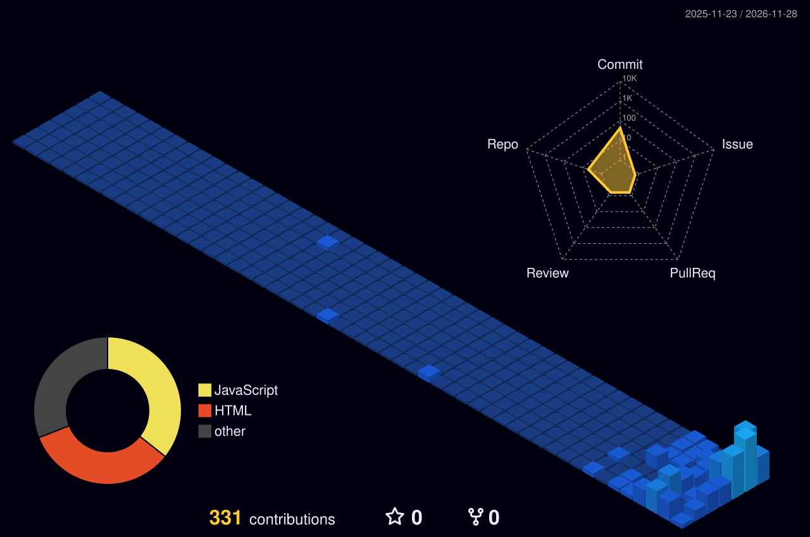

<!--
  Abdelrahman Alrawashdeh — GitHub profile
  Every visual is a hand-built, theme-aware SVG (dark + light) in /assets.
  The 3D contribution calendar is regenerated daily by .github/workflows/profile-visuals.yml
  and published to the `output` branch, so `main` keeps a clean history.
-->

  <picture><source media="(prefers-color-scheme: dark)" srcset="assets/hero-dark.svg"><source media="(prefers-color-scheme: light)" srcset="assets/hero-light.svg"></picture>

  <picture><source media="(prefers-color-scheme: dark)" srcset="assets/highlights-dark.svg"><source media="(prefers-color-scheme: light)" srcset="assets/highlights-light.svg"></picture>

  <picture><source media="(prefers-color-scheme: dark)" srcset="assets/capabilities-dark.svg"><source media="(prefers-color-scheme: light)" srcset="assets/capabilities-light.svg"></picture>

  <picture><source media="(prefers-color-scheme: dark)" srcset="assets/stack-dark.svg"><source media="(prefers-color-scheme: light)" srcset="assets/stack-light.svg"></picture>

  <picture><source media="(prefers-color-scheme: dark)" srcset="assets/title-work-dark.svg"><source media="(prefers-color-scheme: light)" srcset="assets/title-work-light.svg"></picture>

  <a href="https://github.com/Abdelrahman-Alrawashdeh/al-moallem-driving-center"><picture><source media="(prefers-color-scheme: dark)" srcset="assets/work-al-moallem-dark.svg"><source media="(prefers-color-scheme: light)" srcset="assets/work-al-moallem-light.svg"></picture></a>
  <a href="https://github.com/Abdelrahman-Alrawashdeh/alshubbak-alfalastini"><picture><source media="(prefers-color-scheme: dark)" srcset="assets/work-alshubbak-dark.svg"><source media="(prefers-color-scheme: light)" srcset="assets/work-alshubbak-light.svg"></picture></a>

  
    <b>Live:</b>
    <a href="https://almoallem.centerjo.workers.dev/">almoallem.centerjo.workers.dev</a>
    &nbsp;·&nbsp;
    <a href="https://alshubbak-alfalastini.alshubbakalfalastini.workers.dev/">alshubbak-alfalastini.workers.dev</a>
  

  <picture><source media="(prefers-color-scheme: dark)" srcset="assets/title-activity-dark.svg"><source media="(prefers-color-scheme: light)" srcset="assets/title-activity-light.svg"></picture>

  <picture>
    <source media="(prefers-color-scheme: dark)" srcset="https://raw.githubusercontent.com/Abdelrahman-Alrawashdeh/Abdelrahman-Alrawashdeh/output/profile-night-view.svg">
    <source media="(prefers-color-scheme: light)" srcset="https://raw.githubusercontent.com/Abdelrahman-Alrawashdeh/Abdelrahman-Alrawashdeh/output/profile-green-animate.svg">
    
  </picture>

  <picture><source media="(prefers-color-scheme: dark)" srcset="assets/footer-dark.svg"><source media="(prefers-color-scheme: light)" srcset="assets/footer-light.svg"></picture>

